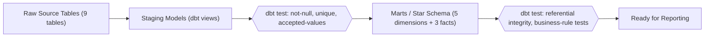
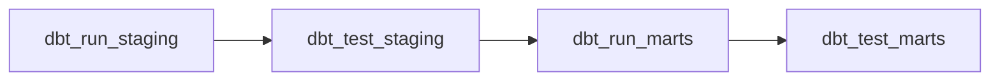
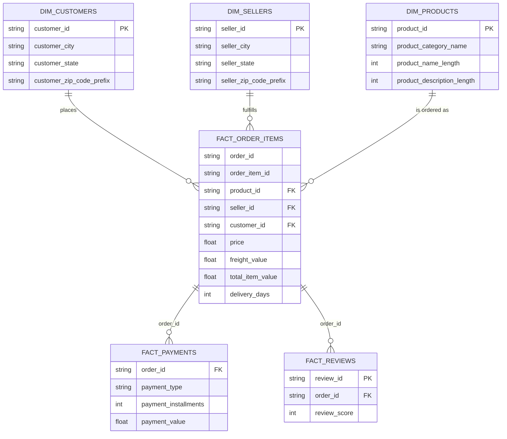
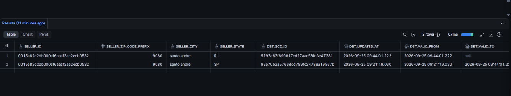
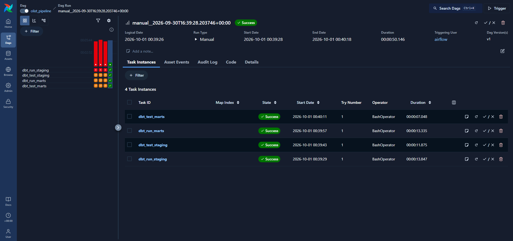

# Olist E-Commerce ELT Pipeline: Snowflake + dbt + Airflow

An end-to-end ELT pipeline on the [Olist Brazilian E-Commerce public dataset](https://www.kaggle.com/datasets/olistbr/brazilian-ecommerce) (~100k orders, 9 source tables). Raw data is loaded into **Snowflake**, transformed into a **star schema** with **dbt Core**, and orchestrated by **Apache Airflow** running in **Docker**, with automated tests acting as quality gates between layers.

**What this project demonstrates**

- **ELT into a cloud warehouse**: 9 raw tables landed in Snowflake, transformed in-warehouse with SQL.
- **Layered modelling**: staging views (cleaning, renaming, typing, dedup) feeding mart tables (5 dimensions + 3 facts).
- **Dimensional modelling**: star schema with conformed date and geolocation dimensions.
- **History tracking**: SCD Type 2 on sellers via a dbt snapshot, verified with a simulated change.
- **Orchestration**: Airflow DAG that runs and tests each layer in order, so a failed test stops bad data from reaching the marts.
- **Containerised runtime**: Airflow + dbt packaged with a Dockerfile and docker-compose.

## Tech Stack

- **Snowflake** - cloud data warehouse
- **dbt Core** - transformation, testing, and snapshots
- **Apache Airflow** - orchestration, containerized with Docker
- **Python / SQL**
- **Git / GitHub** - version control

## Architecture



Orchestrated end to end by an Airflow DAG:



Quality checks gate promotion between layers - if a test stage fails, the next run stage doesn't execute.

## Data Model


 
`dim_geolocation` and `dim_date` are standalone/conformed dimensions, not directly joined to the facts within the dbt models. `dim_geolocation` supports ad hoc joins by zip code (e.g. for map-based BI visuals), and `dim_date` is a generated calendar dimension for ad hoc time-based joins and reporting.
 
**Dimensions:** `dim_customers`, `dim_sellers`, `dim_products`, `dim_geolocation`, `dim_date`
 
**Facts:** `fact_order_items`, `fact_payments`, `fact_reviews`

## Data Quality Gates

- **19 automated dbt tests**: `not_null`, `unique`, `relationships` (referential integrity), `accepted_values`, plus 2 custom singular tests (`assert_no_negative_prices`, `assert_delivery_after_purchase`).
- **3 real data quality defects found and fixed** during ingestion:
  - A CSV header-detection failure on load (Snowflake's upload wizard didn't parse headers correctly for one source file) - fixed by explicitly setting header/delimiter config on re-upload.
  - Genuine typos in the source data itself (`product_name_lenght`, `product_description_lenght`) - corrected via aliasing in the staging layer.
  - A many-to-one duplication issue in raw geolocation data - resolved with a window-function deduplication (`ROW_NUMBER()` partitioned by zip code).
- **Slowly Changing Dimension (Type 2)** history tracking on `dim_sellers.seller_state`, implemented via a dbt snapshot (`check` strategy) and verified with a live simulated data change.

  

## Orchestration

The pipeline is orchestrated by an Airflow DAG (`airflow/dags/olist_pipeline.py`), containerized with Docker. Verified running successfully end to end against the live Snowflake account:



### Troubleshooting notes

- **Docker build failed with SSL errors** on a corporate-managed laptop. Cause: endpoint security software intercepting container traffic.
- **Airflow API server timed out connecting to its Postgres metadata DB** in GitHub Codespaces, reproduced across fresh environments after ruling out executor type and network config.
- **Fix**: the same setup ran cleanly on a personal laptop, so both issues were environment-specific rather than pipeline bugs.

## Setup

1. Create a Snowflake account and load the 9 raw Olist tables into a database (`OLIST`) and schema (`PUBLIC`).
2. Install dbt Core and the Snowflake adapter: `pip install dbt-core dbt-snowflake`
3. Configure `~/.dbt/profiles.yml` with your Snowflake credentials (see `olist_project/dbt_project.yml` for the profile name).
4. From `olist_project/`, run:
```
   dbt run
   dbt test
   dbt snapshot
```
5. To run via Airflow: from `airflow/`, create a `profiles.yml` with your Snowflake credentials (excluded from this repo via `.gitignore`), then:
```
   docker compose build
   docker compose up airflow-init
   docker compose up -d
```
   Open `http://localhost:8080`, enable the `olist_pipeline` DAG, and trigger a run.

## Repository Structure

```
olist-dbt-airflow-snowflake/
├── olist_project/          # dbt project (staging models, marts, snapshots, tests)
│   └── docs/               # Evidence screenshots (Airflow run, SCD2 check)
└── airflow/                # Airflow DAG, Dockerfile, docker-compose.yaml
```

## What I'd do next

- Automate the raw load (Snowpipe or `COPY INTO` from cloud storage) instead of the Snowflake upload wizard.
- Make fact tables incremental (`materialized='incremental'`) so daily runs only process new orders.
- Add CI that runs `dbt build` against a dev schema on every pull request.
